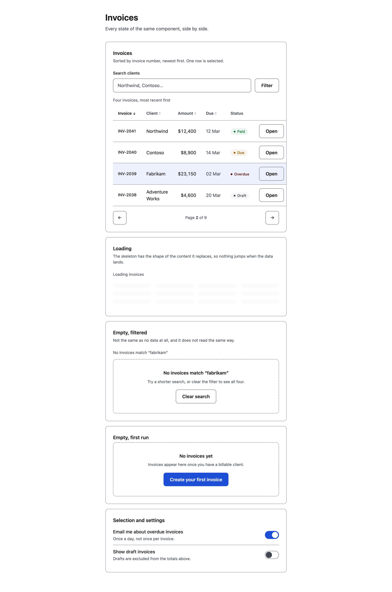
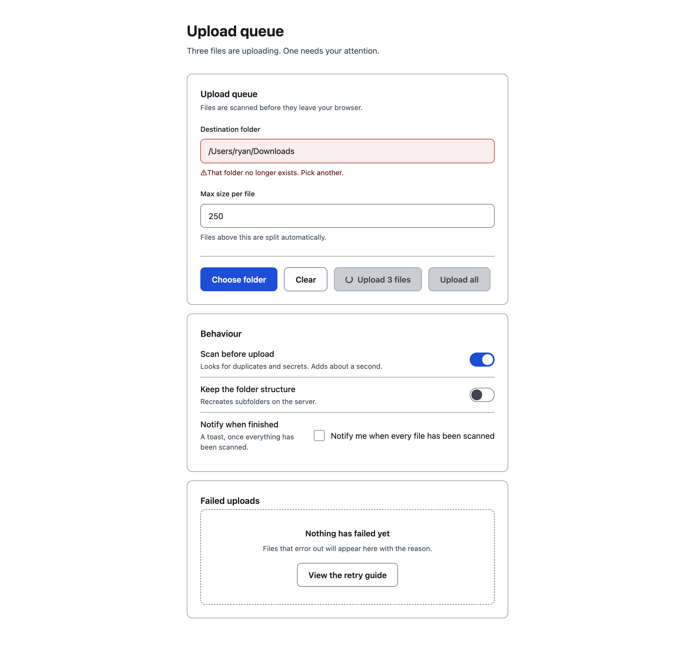

<h1 align="center">States</h1>

<p align="center"><b>A Claude skill that builds an interface as a set of states, not as a screenshot of one.</b><br>
Crafted, accessible, responsive UI with every control's hover, focus, active, disabled,<br>
loading, invalid, empty and error states — and an audit that exits non-zero while one is missing.</p>

<p align="center">
  <a href="https://code.claude.com/docs/en/skills"></a>
  <a href="https://agentskills.io"></a>
  <a href="LICENSE"></a>
  
  
</p>

<p align="center">
  
</p>

<p align="center"><sub><code>examples/invoices</code> — a table is where the state argument is hardest to honour: rows hover, get selected, sort three ways, become a skeleton while loading, and are empty for two entirely different reasons.</sub></p>

<p align="center">
  <a href="#quick-start">Quick start</a> ·
  <a href="#what-it-makes">What it makes</a> ·
  <a href="#install">Install</a> ·
  <a href="#the-three-commands">The three commands</a> ·
  <a href="#how-it-works">How it works</a> ·
  <a href="#examples">Examples</a>
</p>

<p align="center">
  
</p>

Ask Claude for an interface, and States has it invent the **states** before the markup: what the
button looks like pressed, focused, disabled and loading; what the field says when the folder is
gone; what the empty state offers; what happens at 320px. Then it builds it from a token system
whose colours are **computed to pass contrast** rather than chosen by eye, and checks its own work
with three scripts.

```sh
node scripts/audit.mjs page.html                # exits 1 while a state is missing
node scripts/measure.mjs page.html --width 320  # exits 1 while the page scrolls sideways
node scripts/shot.mjs page.html --out shots     # then you look at the PNGs
```

## Quick start

```sh
npx skills add wheresryan22/states -g
```

Then, in Claude Code:

```text
/states build a settings panel for an upload queue, light and dark, with the empty state
```

For Antigravity, OpenCode, Codex, or MiniMax Code, target that agent with `-a`. No API keys and
nothing to `npm install`: the kit uses only Node's built-in modules.

## What it makes

Three kinds, all sharing one kit, one token system and one set of checks.

| Kind | What it is | Where |
|---|---|---|
| **Hand-written reference** | The smallest page that passes with zero errors in both themes | `examples/billing-settings/` |
| **Generated, form** | Components from `kit/ui.mjs`, built by a script that refuses to leave a failing page behind | `examples/upload-queue/` |
| **Generated, table** | Every state of a data table side by side: rows, selected, skeleton, empty-filtered, empty-first-run | `examples/invoices/` |
| **Broken on purpose** | Every defect the audit exists to catch, as a fixture for the audit's own tests | `examples/broken/` |

Every interface is light and dark. Light is the theme the skill designs for first.

## The three commands

Each sees something the others cannot, which is why there are three.

| Command | Sees | Catches | Needs Chrome |
|---|---|---|---|
| `audit` | the stylesheet | missing states, low contrast, unnamed controls, invisible focus, overflow | no |
| `measure` | the real layout | horizontal overflow, painted target sizes | yes |
| `shot` | the real pixels | everything else | yes |

```sh
node scripts/audit.mjs page.html
node scripts/audit.mjs page.html --theme dark --json
node scripts/measure.mjs page.html --width 390
node scripts/shot.mjs page.html --out shots
```

**A page that passes `audit` can still overflow on a phone.** A flex item with a long label and
no `min-width: 0` is a static-analysis no-op and a real bug. That is the reason for `measure`.

`measure` drives Chrome over the DevTools protocol rather than `--screenshot`, because a desktop
Chrome silently refuses a window narrower than 500px and renders at 500 instead — which is how a
page that overflows badly at 390 still screenshots perfectly.

## The eight checks

`node scripts/audit.mjs page.html`. Errors must reach zero; warnings are judgement calls.

| Check | Error means |
|---|---|
| `contrast` | text under the WCAG ratio for its size; disabled text is a note, not an error |
| `tap-target` | a control under 24px tall; 44px is the ideal and a warning |
| `accessible-name` | nothing a screen reader can read; a placeholder does not count |
| `focus-indicator` | no `:focus-visible`, or `outline: none` with nothing in its place |
| `state-coverage` | a control missing a state its kind owes |
| `narrow-overflow` | a declared width that cannot fit in 390px |
| `reduced-motion` | motion with no `prefers-reduced-motion` guard |
| `color-only` | a toggle whose only difference between on and off is a background colour |

## How it works

The kit is four layers, and the point of the arrangement is that **the last layer can say no**.

```
SKILL.md            what to think about, in what order
  └─ references/    the depth: craft, kit, react, verify
       └─ kit/      deterministic code: colour, html, css, state, tokens, ui, audit
            └─ scripts/   the ones that can fail: audit, measure, shot, tests
                 └─ examples/   gold samples, one of them broken on purpose
```

Four decisions do most of the work:

**Contrast is an input, not an outcome.** `palette()` computes a text colour that meets the ratio
you ask for by moving its lightness. Ask for 4.5 and you get 4.5. Nobody can tell 4.5:1 from
4.2:1 by looking, which is why every serious pair of eyes has shipped a 2.8:1 label.

**The states come out of the same function as the markup.** `kit/ui.mjs` emits a button and its
`:hover`, `:focus-visible`, `:active` and `:disabled` rules together. A hand-written button is
missing a state exactly once, and nobody notices until a keyboard user tries it.

**The checks are assertions, not advice.** "Make sure the contrast is high enough" is something
an author talks themselves out of. A script that exits 1 is not. `examples/broken/` exists so the
CI can prove each check still fires — if that fixture ever passes, a check has stopped checking.

**The audit and the browser both talk.** The audit reads the stylesheet; `measure` asks the
browser what it laid out. They disagree in exactly the cases that matter, and the disagreements
are the bugs worth finding.

## Requirements

- **Node.js 20.10 or later.** No dependencies to install.
- **Chrome or Chromium** is optional, needed only for `measure` and `shot`. Without it both
  scripts print why and exit 0, so a build machine without a browser is not a broken build.

## License

MIT.
